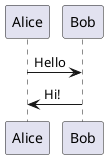
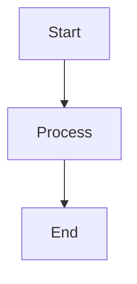

# Pandoc Documentation Creator

[](https://gitlab.com/woofi4/public/pandoc-documentation-creator/-/pipelines)
[](https://gitlab.com/woofi4/public/pandoc-documentation-creator/-/tags)

A complete Docker-based documentation system using Pandoc, LaTeX, and professional templates.

## Quick Start

### Bootstrap with wget (Recommended)

```bash
# Download and run init.sh
wget https://gitlab.com/woofi4/public/pandoc-documentation-creator/-/raw/main/init.sh
chmod +x init.sh
./init.sh build
```

Or with curl:

```bash
# Download and run init.sh
curl -O https://gitlab.com/woofi4/public/pandoc-documentation-creator/-/raw/main/init.sh
chmod +x init.sh
./init.sh build
```

### From Cloned Repository

If you've already cloned the repository:

```bash
git clone https://gitlab.com/woofi4/public/pandoc-documentation-creator.git
cd pandoc-documentation-creator
./init.sh build
```

### 1. Build the Docker Image

```bash
./init.sh build
```

### 2. Create a New Documentation Project

```bash
./init.sh new
```

This creates a complete project structure:

```text
your-project/
├── chapters/           # Your markdown documentation
├── media/             # Images and diagrams
├── out/               # Generated PDFs
│   └── build/         # Build logs and LaTeX artifacts
├── metadata.yaml      # Document metadata (title, author, etc.)
├── build-pdf.sh       # Build script
├── buildPDF           # Build helper run inside Docker
└── Help.md           # Comprehensive help
```

Note: Pandoc configuration (defaults.yaml) is built into the Docker image.
You only need to edit metadata.yaml for document customization.

### 3. Write Your Documentation

Edit the markdown files in `chapters/`:

```markdown
# My Chapter

This is **bold** and this is *italic*.

## Code Example

```python
def hello():
    print("Hello, World!")
```

### 4. Build Your PDF

```bash
./build-pdf.sh
```

The Docker container executes buildPDF to run Pandoc, pdflatex, and bibtex in sequence.

Find your PDF in `out/documentation.pdf`!

## Project Structure

```text
pandoc-documentation-creator/
├── Dockerfile              # Docker image definition
├── init.sh                # Initialization and setup script
├── build-pdf.sh           # PDF build script (for examples)
├── build-pdf-local.sh     # Local build variant
├── buildPDF               # Build helper run inside Docker
├── core/                  # LaTeX templates and headers
│   ├── custom-template.tex
│   ├── header.tex
│   └── listings-languages.tex
├── docker/                # Docker-specific files
│   ├── Dockerfile
│   ├── eisvogel.latex
│   ├── mmdc-wrapper.sh
│   └──  plantuml
├── templates/             # Project templates
│   ├── Help.md.template
│   ├── defaults.yaml.template
│   ├── metadata.yaml.template
│   ├── 01-introduction.md.template
│   ├── 02-example-content.md.template
│   ├── build-pdf.sh.template
│   └── buildPDF.template
├── example/               # Example documentation
│   ├── deckblatt.md
│   └── documentation.md
├── extensions/            # Pandoc extensions
│   ├── extensions.yaml
│   └── metadata.yaml
└── styles/               # Syntax highlighting themes
    └── code/
        └── vscode-light.theme
```

## Configuration

### Metadata (.pandoc/metadata.yaml)

Customize your document:

```yaml
title: "My Documentation"
author: "Your Name"
date: "2026"
lang: "en-US"
documentclass: scrartcl
```

### Defaults (.pandoc/defaults.yaml)

Configure Pandoc behavior:

```yaml
from: markdown
to: pdf
table-of-contents: true
number-sections: true
pdf-engine: xelatex
```

## Usage Examples

### Basic Build

```bash
docker run --rm -v $(pwd):/data pandoc-documentation-creator \
  --defaults=/data/.pandoc/defaults.yaml \
  /data/chapters/*.md \
  -c "pandoc --defaults=/usr/local/share/pandoc/defaults.yaml --metadata-file=/data/metadata.yaml /data/chapters/*.md --to=latex --output /data/out/build/documentation.tex --standalone --verbose --biblatex --top-level-division=chapter > /data/out/build/pandoc.log 2>&1 && cd /data/out/build && pdflatex -halt-on-error documentation.tex && bibtex documentation && pdflatex -halt-on-error documentation.tex && pdflatex -halt-on-error documentation.tex && mv -f /data/out/build/documentation.pdf /data/out/documentation.pdf"
```

### Custom Template

```bash
docker run --rm -v $(pwd):/data pandoc-documentation-creator \
  --template=custom-template.tex \
  chapters/*.md \
  -c "pandoc --defaults=/usr/local/share/pandoc/defaults.yaml --template=custom-template.tex chapters/*.md --to=latex --output out/build/doc.tex --standalone --verbose --biblatex --top-level-division=chapter > out/build/pandoc.log 2>&1 && cd out/build && pdflatex -halt-on-error doc.tex && bibtex doc && pdflatex -halt-on-error doc.tex && pdflatex -halt-on-error doc.tex && mv -f out/build/doc.pdf out/doc.pdf"
```

### With Table of Contents

```bash
docker run --rm -v $(pwd):/data pandoc-documentation-creator \
  --toc \
  --toc-depth=3 \
  chapters/*.md \
  -c "pandoc --defaults=/usr/local/share/pandoc/defaults.yaml --toc --toc-depth=3 chapters/*.md --to=latex --output out/build/doc.tex --standalone --verbose --biblatex --top-level-division=chapter > out/build/pandoc.log 2>&1 && cd out/build && pdflatex -halt-on-error doc.tex && bibtex doc && pdflatex -halt-on-error doc.tex && pdflatex -halt-on-error doc.tex && mv -f out/build/doc.pdf out/doc.pdf"
```

## Features in Detail

### Code Highlighting

Supports multiple languages with VSCode Light theme:

- Python, JavaScript, TypeScript, Java, C#, C++
- Bash, PowerShell, SQL
- JSON, YAML, XML, HTML, CSS
- Dockerfile, Makefile
- And many more...

### Diagrams

#### PlantUML



#### Mermaid



### Typography

- Professional KOMA-Script document classes
- Liberation fonts (Serif, Sans, Mono)
- Customizable spacing and margins
- Beautiful code boxes with line numbers

## Requirements

- Docker
- Bash (for init and build scripts)
- wget or curl (for downloading templates)

## Advanced Usage

### Creating Projects in Specific Directories

```bash
./init.sh new /path/to/my-project
cd /path/to/my-project
./build-pdf.sh
```

### Customizing Templates

1. Copy templates from `templates/` directory
2. Modify as needed
3. Reference in your `.pandoc/defaults.yaml`

### Adding Custom Filters

Add to `metadata.yaml`:

```yaml
# Document metadata is configured here
# Pandoc defaults.yaml is built into the Docker image
```

## Project Structure

This repository is organized as follows:

```text
pandoc-documentation-creator/
├── docker/                     # Docker-related files
│   ├── Dockerfile             # Multi-stage image build
│   ├── .dockerignore          # Docker ignore patterns
│   ├── build-image.sh         # Build script with version management
│   └── scripts/               # Container scripts
│       ├── mmdc-wrapper.sh    # Mermaid wrapper
│       └── plantuml           # PlantUML wrapper
├── pandoc/                     # Pandoc configurations
│   ├── defaults.yaml          # Pandoc defaults (built into image)
│   ├── templates/             # LaTeX templates
│   │   ├── custom-template.tex
│   │   ├── header.tex
│   │   └── listings-languages.tex
│   ├── styles/                # Syntax highlighting themes
│   │   └── code/
│   │       └── vscode-light.theme
│   ├── extensions/            # Pandoc extensions
│   │   ├── extensions.yaml
│   │   └── metadata.yaml
│   └── filters/               # Custom Lua filters
├── scripts/                    # Utility scripts
│   ├── init.sh                # Project initialization
│   ├── build-pdf-local.sh     # Local build script
│   └── build-pdf.sh           # Standard build script
├── templates/                  # User project templates
│   ├── 01-introduction.md.template
│   ├── 02-example-content.md.template
│   ├── build-pdf.sh.template
│   ├── Help.md.template
│   ├── metadata.yaml.template
│   └── README.md
├── examples/                   # Example projects
│   ├── basic/                 # Minimal example
│   └── advanced/              # Full-featured example
├── docs/                       # Documentation
│   └── QUICKSTART.md          # Quick start guide
├── .gitlab/                    # GitLab CI/CD
│   └── gitlab-ci.yml          # CI/CD pipeline
├── VERSION                     # Version number
├── README.md                  # This file
└── LICENCE                    # License information
```

## Docker Image Details

The image includes:

- Pandoc 3.7 with LaTeX
- Python 3 with pandoc filters
- Node.js with Mermaid CLI
- PlantUML with Java runtime
- Chromium for Mermaid rendering
- Comprehensive TeX packages
- VSCode Light syntax theme
- Custom templates and filters

## Troubleshooting

### Docker Build Fails

```bash
# Clear Docker cache
docker system prune -a

# Rebuild
./init.sh build
```

### PDF Generation Fails

1. Check markdown syntax
2. Verify file paths in configuration
3. Check Docker container logs
4. Ensure all referenced files exist

### Missing Fonts

The image includes Liberation fonts. To use custom fonts:

1. Mount font directory: `-v /path/to/fonts:/usr/share/fonts/custom`
2. Update font cache in container
3. Reference fonts in metadata

## Contributing

Contributions welcome! Areas for improvement:

- Additional syntax themes
- More templates
- Additional LaTeX packages
- Documentation improvements
- Bug fixes

## License

See [LICENCE](LICENCE) file for details.

## Credits

Built with:

- [Pandoc](https://pandoc.org/)
- [TeX Live](https://www.tug.org/texlive/)
- [KOMA-Script](https://www.ctan.org/pkg/koma-script)
- [PlantUML](https://plantuml.com/)
- [Mermaid](https://mermaid-js.github.io/)

## Support

- Check Help.md for detailed documentation (created with `./init.sh new`)
- Review example files in `examples/`
- See Pandoc documentation: <https://pandoc.org/MANUAL.html>

---

**Happy documenting!**
