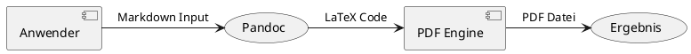
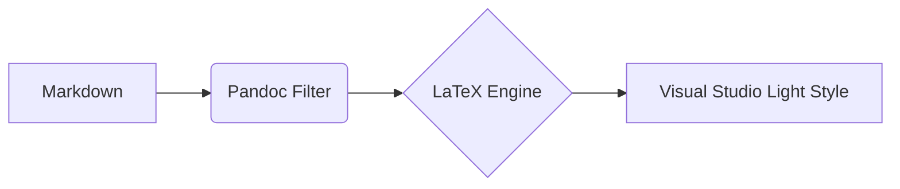

# Typografie & Layout

Dies ist ein Test für das Schriftbild. Wir prüfen hier, ob die Koma-Script Klasse (`scrartcl`) korrekt geladen wurde und die Abstände stimmen.

> **Blockquote Test:** Dies ist ein Test für Zitate. In deinem Template sollte dies durch das `mdframed` Paket mit einem vertikalen grauen Balken am linken Rand hervorgehoben werden.

# Code-Beispiele

## C# Example

```{.cs}
using System;

public class Program {
    public static void Main() {
        if (true) {
            Console.WriteLine("Alles formatiert und in einer Box!");
        }
    }
}
```

## JavaScript Example

```{.js}
import express from 'express';

const app = express();
const PORT = 3000;

app.get('/', (req, res) => {
    res.send('Hello, World!');
});

app.listen(PORT, () => {
    console.log(`Server läuft auf http://localhost:${PORT}`);
});
```

## Python Example

```{.py}
def calculate_fibonacci(n):
    if n <= 1:
        return n
    else:
        return calculate_fibonacci(n-1) + calculate_fibonacci(n-2)

for i in range(10):
    print(f"Fibonacci({i}) = {calculate_fibonacci(i)}")
```

## Java Example

```{.java}
public class HelloWorld {
    public static void main(String[] args) {
        String message = "Hello, World!";
        
        if (args.length > 0) {
            message = args[0];
        }
        
        System.out.println(message);
    }
}
```

## TypeScript Example

```{.ts}
interface User {
    id: number;
    name: string;
    email: string;
}

async function fetchUser(userId: number): Promise<User> {
    const response = await fetch(`/api/users/${userId}`);
    
    if (!response.ok) {
        throw new Error('Failed to fetch user');
    }
    
    return response.json();
}
```

## Go Example

```{.go}
package main

import (
    "fmt"
    "time"
)

func main() {
    messages := make(chan string)
    
    go func() {
        time.Sleep(2 * time.Second)
        messages <- "Hello from goroutine!"
    }()
    
    msg := <-messages
    fmt.Println(msg)
}
```

## Rust Example

```{.rust}
fn main() {
    let numbers = vec![1, 2, 3, 4, 5];
    
    let sum: i32 = numbers.iter()
        .filter(|&x| x % 2 == 0)
        .map(|&x| x * x)
        .sum();
    
    println!("Sum of squared even numbers: {}", sum);
}
```

## PHP Example

```{.php}
<?php
class DatabaseConnection {
    private $host = "localhost";
    private $username = "root";
    
    public function connect() {
        try {
            $pdo = new PDO("mysql:host={$this->host}", $this->username);
            return $pdo;
        } catch (PDOException $e) {
            echo "Connection failed: " . $e->getMessage();
        }
    }
}
?>
```

## Ruby Example

```{.ruby}
class BankAccount
  attr_reader :balance
  
  def initialize(initial_balance)
    @balance = initial_balance
  end
  
  def deposit(amount)
    if amount > 0
      @balance += amount
      puts "Deposited: $#{amount}"
    end
  end
  
  def withdraw(amount)
    if amount <= @balance
      @balance -= amount
      puts "Withdrawn: $#{amount}"
    else
      puts "Insufficient funds"
    end
  end
end
```

## SQL Example

```sql
SELECT 
    u.id,
    u.name,
    COUNT(o.id) AS order_count,
    SUM(o.total) AS total_spent
FROM users u
LEFT JOIN orders o ON u.id = o.user_id
WHERE u.created_at >= '2024-01-01'
GROUP BY u.id, u.name
HAVING COUNT(o.id) > 5
ORDER BY total_spent DESC
LIMIT 10;
```

## Bash/Shell Example

```{.bash}
#!/bin/bash

LOG_FILE="/var/log/backup.log"

function backup_database() {
    local db_name=$1
    local backup_dir="/backups"
    
    if [ ! -d "$backup_dir" ]; then
        mkdir -p "$backup_dir"
    fi
    
    echo "Starting backup of $db_name..."
    
    for i in {1..3}; do
        if mysqldump "$db_name" > "$backup_dir/${db_name}_$(date +%Y%m%d).sql"; then
            echo "Backup successful!" | tee -a "$LOG_FILE"
            return 0
        else
            echo "Attempt $i failed, retrying..."
            sleep 2
        fi
    done
}

backup_database "production_db"
```

## Dockerfile Example

```dockerfile
FROM node:18-alpine

WORKDIR /app

COPY package*.json ./

RUN npm ci --only=production

COPY . .

EXPOSE 3000

ENV NODE_ENV=production

CMD ["node", "server.js"]
```

## YAML Example

```{.yaml}
version: '3.8'

services:
  web:
    image: nginx:latest
    ports:
      - "80:80"
    volumes:
      - ./html:/usr/share/nginx/html
    environment:
      - NGINX_HOST=example.com
      - NGINX_PORT=80
    depends_on:
      - api
      
  api:
    build: ./api
    ports:
      - "3000:3000"
    environment:
      DATABASE_URL: postgres://user:pass@db:5432/mydb
    restart: unless-stopped
```

## JSON Example

```{.json}
{
  "name": "pandoc-documentation-creator",
  "version": "1.0.0",
  "description": "Professional PDF documentation generator",
  "main": "index.js",
  "scripts": {
    "build": "./build-pdf.sh",
    "test": "jest"
  },
  "dependencies": {
    "express": "^4.18.0",
    "dotenv": "^16.0.0"
  },
  "devDependencies": {
    "jest": "^29.0.0"
  }
}
```

# Mathematik

LaTeX-Support Test für komplexe Formeln (Standardabweichung): $$ \sigma = \sqrt{\frac{(p - o)^2}{36}} $$

# Diagramme

## PlantUML



## Mermaid


