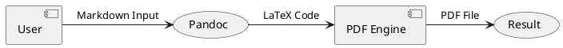
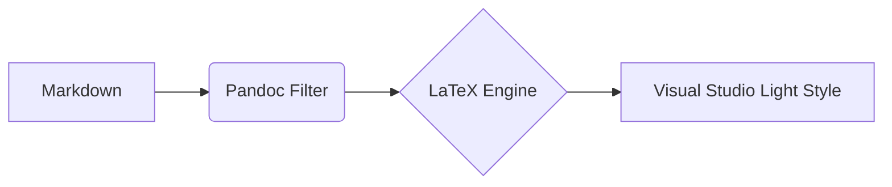

# Typography & Layout

This is a test for the typography. We check here whether the KOMA-Script class (`scrartcl`) is loaded correctly and the spacing is correct.

Example of a citation with BibTeX: see @knuth1984.

> **Blockquote Test:** This is a test for quotations. In your template, this should be highlighted by the `mdframed` package with a vertical gray bar on the left edge.

# Code Examples

## References to Code Blocks

You can link to code blocks by their ID. Example: see [C# code example](#code-csharp).

## C# Example

```csharp{#code-csharp .cs caption="C# example"}
using System;

public class Program {
    public static void Main() {
        if (true) {
            Console.WriteLine("Everything formatted and in a box!");
        }
    }
}

public class MyClass {
    public static void Main() {
        Console.WriteLine("Hello MyClass");
    }
}
```

## JavaScript Example

```javascript{#code-js .js caption="JavaScript example"}
import express from 'express';

const app = express();
const PORT = 3000;

app.get('/', (req, res) => {
  res.send('Hello, World!');
});

app.listen(PORT, () => {
  console.log(`Server running at http://localhost:${PORT}`);
});
```

## Python Example

```python{#code-python .py caption="Python example"}
def calculate_fibonacci(n):
    if n <= 1:
        return n
    else:
        return calculate_fibonacci(n-1) + calculate_fibonacci(n-2)

for i in range(10):
    print(f"Fibonacci({i}) = {calculate_fibonacci(i)}")
```

## Java Example

```java{#code-java .java caption="Java example"}
public class HelloWorld {
    public static void main(String[] args) {
        String message = "Hello, World!";
        
        if (args.length > 0) {
            message = args[0];
        }
        
        System.out.println(message);
    }
}
```

## TypeScript Example

```typescript{#code-typescript .ts caption="TypeScript example"}
interface User {
    id: number;
    name: string;
    email: string;
}

async function fetchUser(userId: number): Promise<User> {
    const response = await fetch(`/api/users/${userId}`);
    
    if (!response.ok) {
        throw new Error('Failed to fetch user');
    }
    
    return response.json();
}
```

## Go Example

```go{#code-go .go caption="Go example"}
package main

import (
    "fmt"
    "time"
)

func main() {
    messages := make(chan string)
    
    go func() {
        time.Sleep(2 * time.Second)
        messages <- "Hello from goroutine!"
    }()
    
    msg := <-messages
    fmt.Println(msg)
}
```

## Rust Example

```rust{#code-rust .rust caption="Rust example"}
fn main() {
    let numbers = vec![1, 2, 3, 4, 5];
    
    let sum: i32 = numbers.iter()
        .filter(|&x| x % 2 == 0)
        .map(|&x| x * x)
        .sum();
    
    println!("Sum of squared even numbers: {}", sum);
}
```

## PHP Example

```php{#code-php .php caption="PHP example"}
<?php
class DatabaseConnection {
    private $host = "localhost";
    private $username = "root";
    
    public function connect() {
        try {
            $pdo = new PDO("mysql:host={$this->host}", $this->username);
            return $pdo;
        } catch (PDOException $e) {
            echo "Connection failed: " . $e->getMessage();
        }
    }
}
?>
```

## Ruby Example

```ruby{#code-ruby .ruby caption="Ruby example"}
class BankAccount
  attr_reader :balance
  
  def initialize(initial_balance)
    @balance = initial_balance
  end
  
  def deposit(amount)
    if amount > 0
      @balance += amount
      puts "Deposited: $#{amount}"
    end
  end
  
  def withdraw(amount)
    if amount <= @balance
      @balance -= amount
      puts "Withdrawn: $#{amount}"
    else
      puts "Insufficient funds"
    end
  end
end
```

## SQL Example

```sql{#code-sql .sql caption="SQL example"}
SELECT 
    u.id,
    u.name,
    COUNT(o.id) AS order_count,
    SUM(o.total) AS total_spent
FROM users u
LEFT JOIN orders o ON u.id = o.user_id
WHERE u.created_at >= '2024-01-01'
GROUP BY u.id, u.name
HAVING COUNT(o.id) > 5
ORDER BY total_spent DESC
LIMIT 10;
```

## Bash/Shell Example

```bash{#code-bash .bash caption="Bash example"}
#!/bin/bash

LOG_FILE="/var/log/backup.log"

function backup_database() {
    local db_name=$1
    local backup_dir="/backups"
    
    if [ ! -d "$backup_dir" ]; then
        mkdir -p "$backup_dir"
    fi
    
    echo "Starting backup of $db_name..."
    
    for i in {1..3}; do
        if mysqldump "$db_name" > "$backup_dir/${db_name}_$(date +%Y%m%d).sql"; then
            echo "Backup successful!" | tee -a "$LOG_FILE"
            return 0
        else
            echo "Attempt $i failed, retrying..."
            sleep 2
        fi
    done
}

backup_database "production_db"
```

## Dockerfile Example

```dockerfile{#code-dockerfile .dockerfile caption="Dockerfile example"}
FROM node:18-alpine

WORKDIR /app

COPY package*.json ./

RUN npm ci --only=production

COPY . .

EXPOSE 3000

ENV NODE_ENV=production

CMD ["node", "server.js"]
```

## YAML Example

```yaml{#code-yaml .yaml caption="YAML example"}
version: '3.8'

services:
  web:
    image: nginx:latest
    ports:
      - "80:80"
    volumes:
      - ./html:/usr/share/nginx/html
    environment:
      - NGINX_HOST=example.com
      - NGINX_PORT=80
    depends_on:
      - api
      
  api:
    build: ./api
    ports:
      - "3000:3000"
    environment:
      DATABASE_URL: postgres://user:pass@db:5432/mydb
    restart: unless-stopped
```

## JSON Example

```json{#code-json .json caption="JSON example"}
{
  "name": "pandoc-documentation-creator",
  "version": "1.0.0",
  "description": "Professional PDF documentation generator",
  "main": "index.js",
  "scripts": {
    "build": "docker run --rm -v $(pwd):/data --entrypoint=/bin/sh registry.gitlab.com/woofi4/public/pandoc-documentation-creator:${VERSION} -c /data/buildPDF",
    "test": "jest"
  },
  "dependencies": {
    "express": "^4.18.0",
    "dotenv": "^16.0.0"
  },
  "devDependencies": {
    "jest": "^29.0.0"
  }
}
```

## C Example

```c{#code-c .c caption="C example"}
#include <stdio.h>

int main(void) {
    int numbers[] = {1, 2, 3, 4, 5};
    int sum = 0;

    for (int i = 0; i < 5; i++) {
        sum += numbers[i];
    }

    printf("Sum: %d\n", sum);
    return 0;
}
```

## C++ Example

```cpp{#code-cpp .cpp caption="C++ example"}
#include <iostream>
#include <vector>

int main() {
    std::vector<int> values{1, 2, 3, 4, 5};
    int sum = 0;

    for (int v : values) {
        sum += v;
    }

    std::cout << "Sum: " << sum << std::endl;
    return 0;
}
```

## Kotlin Example

```kotlin{#code-kotlin .kt caption="Kotlin example"}
data class User(val id: Int, val name: String)

fun main() {
    val users = listOf(User(1, "Ada"), User(2, "Linus"))
    val names = users.map { it.name }.joinToString(", ")
    println("Users: $names")
}
```

## Swift Example

```swift{#code-swift .swift caption="Swift example"}
struct Product {
    let name: String
    let price: Double
}

let products = [Product(name: "Book", price: 12.5), Product(name: "Pen", price: 2.0)]
let total = products.reduce(0.0) { $0 + $1.price }
print("Total: \(total)")
```

## HTML Example

```html{#code-html .html caption="HTML example"}
<!doctype html>
<html lang="en">
  <head>
    <meta charset="utf-8" />
    <title>Example</title>
  </head>
  <body>
    <main>
      <h1>Hello, HTML</h1>
      <p>This is a simple document.</p>
    </main>
  </body>
</html>
```

## CSS Example

```css{#code-css .css caption="CSS example"}
:root {
  --primary: #1f4e79;
}

body {
  font-family: system-ui, sans-serif;
  color: #111;
  margin: 2rem;
}

h1 {
  color: var(--primary);
}
```

## XML Example

```xml{#code-xml .xml caption="XML example"}
<?xml version="1.0" encoding="UTF-8"?>
<catalog>
  <book id="bk101">
    <title>Example</title>
    <author>Jane Doe</author>
  </book>
</catalog>
```

## R Example

```r{#code-r .r caption="R example"}
numbers <- c(1, 2, 3, 4, 5)
sum_value <- sum(numbers)
mean_value <- mean(numbers)
cat("Sum:", sum_value, "Mean:", mean_value, "\n")
```

## MATLAB Example

```matlab{#code-matlab .m caption="MATLAB example"}
values = [1, 2, 3, 4, 5];
total = sum(values);
average = mean(values);
fprintf('Sum: %d, Mean: %.2f\n', total, average);
```

# Mathematics

LaTeX support test for complex formulas (standard deviation): $$ \sigma = \sqrt{\frac{(p - o)^2}{36}} $$

# Diagrams

## PlantUML



## Mermaid



Thanks for your trust in testing this advanced documentation example!

# Tables

| Language   | Code Example      | Description                                    |
|------------|-------------------|------------------------------------------------|
| C#         | `code-csharp`     | A simple C# program                            |
| JavaScript | `code-js`         | A simple Express.js server                     |
| Python     | `code-python`     | A simple Fibonacci program                     |
| Java       | `code-java`       | A simple Java HelloWorld                       |
| TypeScript | `code-typescript` | A simple TypeScript example                    |
| Go         | `code-go`         | A simple Go goroutine example                  |
| Rust       | `code-rust`       | A simple Rust example                          |
| PHP        | `code-php`        | A simple PHP database connection example       |
| Ruby       | `code-ruby`       | A simple Ruby BankAccount example              |
| SQL        | `code-sql`        | Aggregation query with joins                   |
| Bash       | `code-bash`       | Backup script example                          |
| Dockerfile | `code-dockerfile` | Docker image build example                     |
| YAML       | `code-yaml`       | Service definitions for containers             |
| JSON       | `code-json`       | Package metadata example                       |
| C          | `code-c`          | Array summation example                        |
| C++        | `code-cpp`        | Vector summation example                       |
| Kotlin     | `code-kotlin`     | Data class and list mapping example            |
| Swift      | `code-swift`      | Reduce over structs example                    |
| HTML       | `code-html`       | Basic page structure                           |
| CSS        | `code-css`        | Simple styling example                         |
| XML        | `code-xml`        | Basic catalog structure                        |
| R          | `code-r`          | Sum and mean calculation                       |
| MATLAB     | `code-matlab`     | Sum and mean calculation                       |

# Columns

You can create columns using the `columns` directive:

:::columns
:::column

```{#code-python .python caption="Python code in column"}
print("This is the first column.")
```

:::

:::column

```{#code-javascript .javascript caption="JavaScript code in column"}
console.log("This is the second column.");
```

:::
:::
